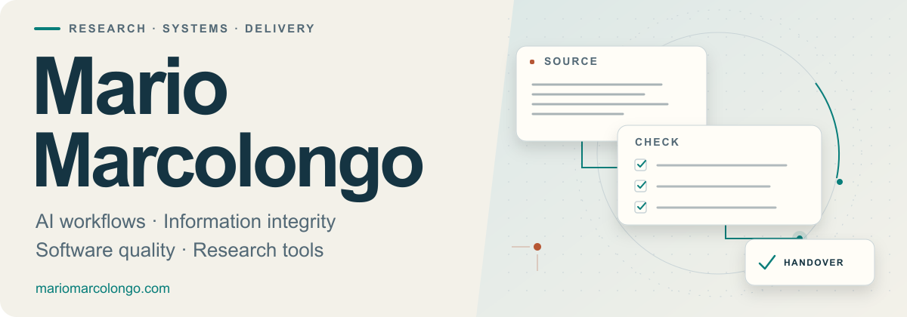
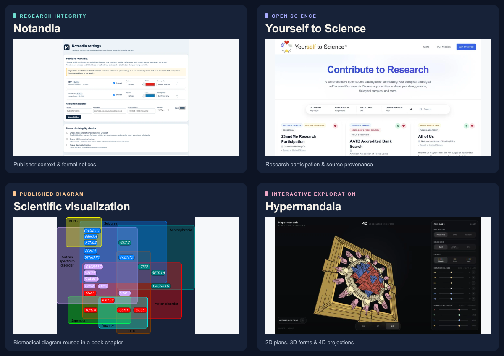

<a href="https://mariomarcolongo.com">
<picture>
  <source media="(prefers-reduced-motion: reduce) and (prefers-color-scheme: dark)" srcset="assets/profile-dark.png">
  <source media="(prefers-reduced-motion: reduce)" srcset="assets/profile-light.png">
  <source media="(prefers-color-scheme: dark)" srcset="assets/profile-dark.gif">
  <source media="(prefers-color-scheme: light)" srcset="assets/profile-light.gif">
  
</picture>
</a>

I configure practical workflows, investigate sources, and test software and AI behavior. My work combines **paid client delivery**, **accepted open-source contributions**, and **independent research tools**.

[Portfolio & case studies](https://mariomarcolongo.com) · [Technical CV](https://mariomarcolongo.com/cv-technical) · [LinkedIn](https://www.linkedin.com/in/mario-marcolongo) · [Contact](mailto:me@mariomarcolongo.com)

## Work in use

### Paid workflows & client training · Entropy for Life

Scientific research, fact-checking, visualizations and website delivery since 2023. Since October 2026, I have also configured reusable AI-assisted media workflows with Antigravity, Gemini and Google Drive, reviewed outputs and trained the client to run the setup independently.

The client used the workflow to rename and add metadata to **thousands of images and hundreds of videos**, addressing a major bottleneck in the video pipeline. He continues adding new material and is extending its use to other work.

[Work, responsibilities & attribution](https://mariomarcolongo.com/work/entropy)

### Agent instructions & source audits · AI Safety Formalization Atlas

I researched official platform guidance, wrote a cross-platform instruction-design reference and reorganized repository guidance into task-scoped policies. [Accepted PR #61](https://github.com/mbrcic/ai-safety-formalization-atlas/pull/61) · [Read the guide](https://github.com/mbrcic/ai-safety-formalization-atlas/blob/66ceba19c1904f00b2a734486ee0de3f5fc5a470/docs/guide/agent-instruction-design.md)

Other merged work includes a [source metadata and rights-evidence audit](https://github.com/mbrcic/ai-safety-formalization-atlas/pull/69), [citation locators and publication provenance](https://github.com/mbrcic/ai-safety-formalization-atlas/pull/70), and [macOS/Linux validation fixes](https://github.com/mbrcic/ai-safety-formalization-atlas/pull/52). I am a [coauthor of the Atlas preprint](https://doi.org/10.5281/zenodo.23088952).

## Explore the work

<a href="https://mariomarcolongo.com/work">
<picture>
  <source media="(max-width: 600px)" srcset="assets/project-gallery-mobile.png">
  
</picture>
</a>

- **[Notandia](https://github.com/notandia/browser-extension):** research-integrity tools I created and maintain, used by my team at Entropy for Life. Publisher context and formal article notices remain distinct signals. [Case study](https://mariomarcolongo.com/notandia) · [Zotero companion](https://github.com/notandia/zotero-plugin)
- **[Yourself to Science](https://yourselftoscience.org/):** founder and maintainer of a research-participation directory; inclusion criteria, curation, source provenance and update workflows. [Source](https://github.com/yourselftoscience/yourselftoscience.org)
- **[Scientific visualization](https://mariomarcolongo.com/work/scientific-visualizations):** diagrams, Tableau maps and Flourish stories. My biomedical diagram was reused in a Palgrave Macmillan / Springer Nature book chapter. [Original, reuse & attribution](https://mariomarcolongo.com/work/wikimedia#diagram-reuse)
- **[Hypermandala](https://hypermandala.mariomarcolongo.com/):** an interactive geometry experiment connecting 2D plans, 3D forms and 4D projections. [Source](https://github.com/mariomarcolongo/hypermandala)

## Testing & investigations

- **Software and localization QA:** terminology, browser checks, keyboard navigation and release verification across Notandia, the [QCAE interface](https://mariomarcolongo.com/work/qcae) and the [Wikipedia link converter](https://github.com/mariomarcolongo/english-wikipedia-link-converter-telegram-bot).
- **AI evaluation:** independent adversarial testing through Gray Swan, examining instruction-following failures and response patterns. [Methods & dated results](https://mariomarcolongo.com/ai-evaluation)
- **Source investigations:** archived-source recovery, bibliographic checks, scientific and technical translation, and bilingual Wikidata terminology. [Public cases](https://mariomarcolongo.com/investigations) · [Wikimedia work](https://mariomarcolongo.com/work/wikimedia)

## Work with me

I work with organisations, research teams and creators on **AI workflows and training**, **source and data-quality reviews**, and **software QA and verified fixes**. Available for scoped projects, ongoing collaborations and relevant employed roles.

Based in Italy · Italian/EU citizen · Open to international remote work and relocation.

For a project, [email me](mailto:me@mariomarcolongo.com) with the problem, intended users, outcome, timeline and indicative budget. **Follow for practical workflow notes, testing and research tools.**

Background, assessed learning & contribution scope

- **Metropolia Open UAS:** Information Technology path studies, online in English; Python Programming, 3 awarded ECTS, Pass. Continuing Python, SQL and quantitative foundations.
- **Microsoft Applied Skills:** [Build an agent in Microsoft Copilot Studio](https://learn.microsoft.com/en-us/users/mariomarcolongo/credentials/48386317f9899eb1).
- **Atlassian:** [Credentialed in JSM Fundamentals with AI](https://cp.certmetrics.com/atlassian/en/public/verify/credential/4ec41335733f49508b42ab3faab010d1). Assessed learning is separate from commercial platform delivery.
- **Syntony Research:** Trusted Red Team Network member; project scope and compensation are agreed for individual engagements.
- I use AI extensively for software implementation in my own projects. My responsibilities include requirements, code and behavior inspection, testing, troubleshooting and maintenance. Linked case studies describe my contribution. QCAE implements an existing instrument; interface work is separate from psychometric validation.

[Full experience](https://mariomarcolongo.com/experience) · [Research CV](https://mariomarcolongo.com/cv) · [AI evaluation CV](https://mariomarcolongo.com/cv-ai) · [Source-backed profile](https://mariomarcolongo.com/profile.json)

